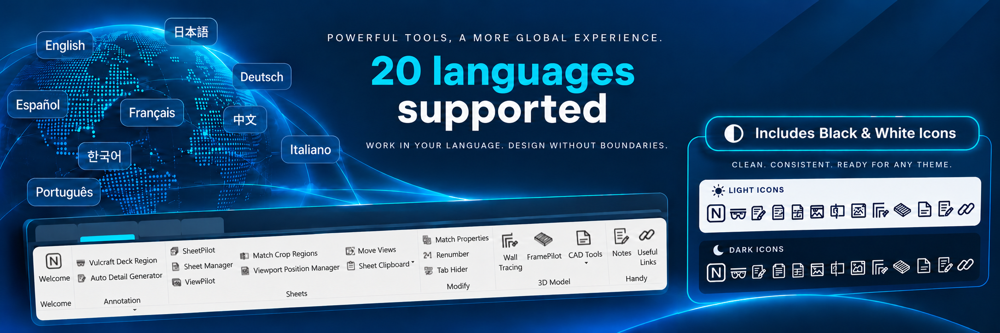

# NdevTools translated ribbon metadata

All **21 command bundles** contain titles and tooltip descriptions for these 20
pyRevit locale options: `ar`, `pt_br`, `bg`, `chinese_s`, `chinese_t`, `cs`,
`nl_nl`, `en_gb`, `en_us`, `fa`, `fr_fr`, `de_de`, `hu`, `it_it`, `ja`, `ko`,
`pl`, `ru`, `es_es`, and `uk`. Product names such as ViewPilot and FramePilot
remain unchanged where appropriate.

The six ribbon panels contain one Welcome command, two Annotation commands, nine Sheets commands, three Modify commands, four 3D Model commands and two Handy commands. The Sheets count includes Cut, Copy and Paste in the localized Sheet Clipboard dropdown. Each command includes `icon.png` for a light
background and `icon.dark.png` for a dark background.

An explicit **pyRevit Settings → Language** choice takes priority. Otherwise,
the shared helper follows the Revit interface language; unavailable UI strings
fall back to English. Spelling-dictionary variants are not interface locales.

`NdevTools.tab/lib/ribbon_translations.json` is generated from the current
`bundle.yaml` title/tooltip mappings. The one-shot startup ribbon synchronizer
reads this catalog, so it must be updated whenever those mappings change.
The catalog uses current bundle names, including `Create walls and opening`,
ViewPilot, FramePilot, Notes and Useful Links. It no longer restores old wall
descriptions or the printed Notes/Useful Links developer profile URLs.

Sheet Clipboard has catalog entries for `Clipboard`, `Cut`, `Copy` and `Paste`. Each entry has a title and tooltip in all 20 locales. The dropdown, Copy and Paste tooltips describe cross-project transfers of sheet graphics and section details. The picker and paste result use the JSON files in the [Sheet Clipboard locale folder](NdevTools.tab/Sheets.panel/col3.stack/Clipboard.pulldown/locales).

CAD Tools, CAD to Walls and CAD to Grids have bundle titles and tooltips in the same 20 locales, with matching runtime catalog entries. The CAD Tools menu contains Walls and Grids only.

Layout-only tab, panel and stack bundles do not need tooltip translations.
Custom dialogs and dynamic messages may still contain English; ribbon coverage
does not mean every dialog is fully localized. Native-speaker review remains
useful for engineering terminology and right-to-left presentation.

See [localization details](media/docs/LOCALIZATION.md) and the
[current ribbon overview](README.md#ribbon-layout).
