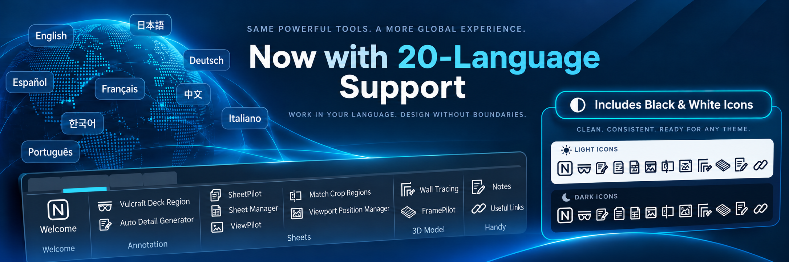
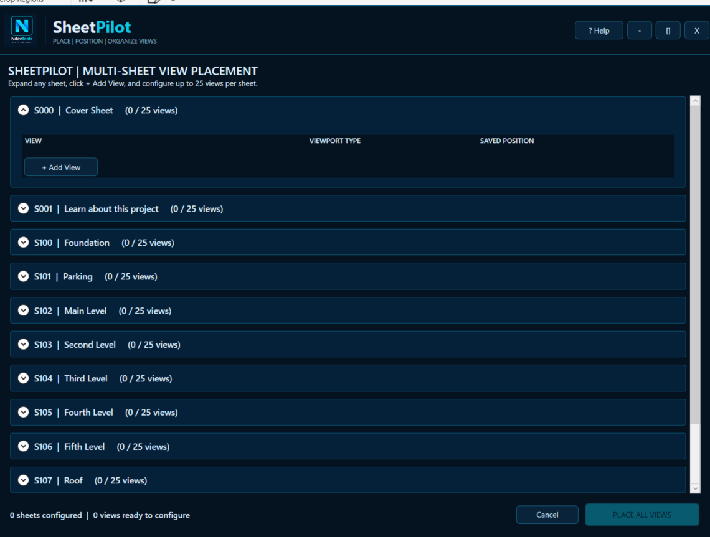
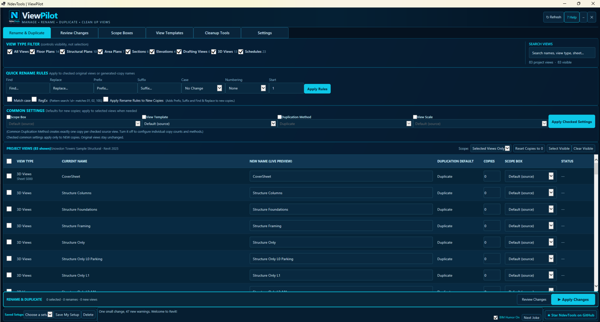
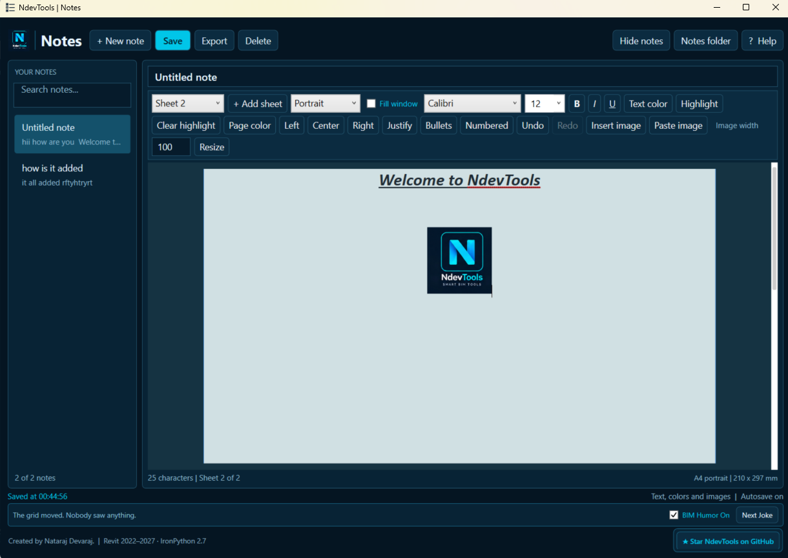

# NdevTools | Smart BIM Tools



**NdevTools supports 20 language options** for pyRevit ribbon button titles and bundle tooltip descriptions, with black icons for light themes and white icons for dark themes. The tool commands remain the same across languages.

**NdevTools** is a collection of Autodesk Revit productivity commands built for **pyRevit**. The extension combines model-based detailing, view and sheet management, linked-model wall/opening tracing, structural framing, and personal productivity tools in one ribbon tab. It is developed by **Nataraj Devaraj**.

**GitHub:** [ndev16/NdevTools](https://github.com/ndev16/NdevTools)  
**Feedback and feature requests:** [GitHub Issues](https://github.com/ndev16/NdevTools/issues)

## Multilingual support — 20 languages

NdevTools includes localized **ribbon titles and bundle tooltip descriptions for all 12 commands** in the following 20 pyRevit locale options:

| Language | Locale code | Language | Locale code |
| --- | --- | --- | --- |
| Arabic | `ar` | Brazilian Portuguese | `pt_br` |
| Bulgarian | `bg` | Chinese (Simplified) | `chinese_s` |
| Chinese (Traditional) | `chinese_t` | Czech | `cs` |
| Dutch | `nl_nl` | English (Great Britain) | `en_gb` |
| English (USA) | `en_us` | Farsi (Persian) | `fa` |
| French | `fr_fr` | German | `de_de` |
| Hungarian | `hu` | Italian | `it_it` |
| Japanese | `ja` | Korean | `ko` |
| Polish | `pl` | Russian | `ru` |
| Spanish | `es_es` | Ukrainian | `uk` |

**Language selection:** An explicit **pyRevit Settings → Language** choice takes priority. With no override, NdevTools follows the active Revit interface language. Unavailable UI strings fall back to English. Revit's spelling-dictionary preference does not change its interface language.

**Localization scope:** The 20-language coverage applies to button titles and bundle tooltip descriptions for all 12 commands. Some longer, dynamically generated messages and custom dialog text may remain in English. Translations, especially specialized engineering terminology and right-to-left presentation, should be reviewed by native speakers. See [Bundle translations](BUNDLE_TRANSLATIONS.md) for details.

**Theme icons:** Each of the 12 commands includes `icon.png` (dark/black artwork for a light background) and `icon.dark.png` (white artwork for a dark background). Availability of theme switching depends on the Revit/pyRevit version.

## Ribbon layout


| Panel | Ribbon button | Purpose |
| --- | --- | --- |
| **Welcome** | Welcome | Show NdevTools information, useful links and contact details. |
| **Annotation** | Vulcraft Deck Region | Create a concrete filled region that follows a selected Vulcraft structural deck profile in section. |
| **Annotation** | Auto Detail Generator | Trace selected host-model geometry into 2D filled regions, lines and supported detail components. |
| **Sheets** | SheetPilot | Configure and place up to 25 unplaced views per sheet across multiple sheets using saved viewport positions. |
| **Sheets** | Sheet Manager | Create sheets in bulk or rename existing sheets. |
| **Sheets** | Match Crop Regions | Apply one plan view's crop region to multiple compatible plan views. |
| **Sheets** | Viewport Position Manager | Save, rename, manage and reuse named sheet viewport positions. |
| **Sheets** | ViewPilot | Review and batch rename, duplicate, and assign compatible view settings. |
| **3D Model** | Wall Tracing | Trace supported structural walls and verified rectangular openings from an architectural link. |
| **3D Model** | FramePilot | Create structural framing for Roof, Flat Truss, Floor and Ceiling hosts, or sketch a beam system. |
| **Handy** | Notes | Write formatted, illustrated notes with multiple A4 portrait/landscape sheets and local saving. |
| **Handy** | Useful Links | Use Image to Text and Convert Case in a modeless embedded browser. |

## Tools and usage

### Welcome

Open the **Welcome** button in the Welcome panel to view the extension's information and the developer's GitHub, LinkedIn and feedback links. The Welcome command is for information and navigation; it does not modify the open Revit model.

### Annotation → Vulcraft Deck Region

Create a static **concrete filled region** based on the corrugated profile of structural metal decking in a straight Revit section view.

**Supported deck configurations:** Vulcraft **1.5C-36, 2C-36 and 3C-36**, with the selectable gages offered by the command. The profile uses deck dimensions such as depth, pitch, upper and lower flats.

**Typical workflow:** Open a straight section, select the structural floor, choose the deck profile and gage, pick the **left end of a lower flat** as the profile anchor, and select the desired Revit filled-region type. The command generates a concrete region aligned to the deck geometry, with profile extent clipped to the selected floor boundaries.

**Scope:** Requires a valid selected structural floor, visible deck geometry and an accurately picked anchor. The result is 2D view-specific annotation, not replacement 3D geometry.

### Annotation → Auto Detail Generator

Create 2D construction-detail representations from visible, supported host-model elements in **plan views and straight sections**.

**Supported model categories:** floors, walls, roofs, structural foundations and structural framing.

**Typical workflow:** Open a supported view, launch Auto Detail Generator, choose a filled-region type and outline style for each model category, select the model elements, and create the view-specific detailing. Choose **No Fill** with a line style where you prefer detail lines instead of filled regions.

**Additional detailing options:**

- **Roofs:** place compatible line-based detail components along straight roof slopes in sections or roof top-face edges in plans.
- **Floors:** place line-based detail components along traced horizontal floor segments, splitting at openings where applicable.
- **Structural framing:** choose a loaded point-based or line-based detail component, or **None**, and align detail components with the traced framing center.
- **CMU walls:** replicate repeating-detail instances horizontally or vertically in sections using an existing instance as a template.

**Scope:** Creates static 2D representations. Curved roof edges are not supported. The command traces host-model elements; plan wall tracing uses the main view cut height, not the cut heights of individual plan regions.

### Sheets → SheetPilot (Place Views on Sheet)

**Place and organize views.** Configure up to 25 views per sheet, choose viewport types, and reuse saved positions. Prepare multiple sheets in one window, then place the configured views together.



**Sheet Pilot** automates placing unplaced views on multiple Revit sheets using named X/Y positions saved by **Viewport Position Manager** (or the compatible Crop Position Manager). Configure multiple sheets in one window, with up to **25 views per sheet**.

**Prerequisites — save a sheet position first:**

1. Manually place a reference view on a Revit sheet and arrange its viewport where you want it.
2. Open **Viewport Position Manager**, select the placed viewport, and use **Save New Position** or **Capture New Position + Apply** to acquire and save the viewport's X/Y sheet position under a recognizable name.
3. Repeat for any additional sheet locations needed. **At least one saved position is required** for Sheet Pilot. Saved positions are maintained separately by Revit version.

**Typical workflow:** Open Sheet Pilot, expand a target sheet, select **+ Add View**, choose an available unplaced view, its viewport type, and a saved position. Repeat for other views and sheets, then click **PLACE ALL VIEWS**. The same saved position can be selected again where appropriate; review placements to prevent overlaps.

**Placement and safety:** For standard viewports, the tool first creates a viewport at a temporary sheet location, then moves the existing viewport to the selected saved X/Y coordinate. For supported plan views it temporarily hides the four visibility category groups and Revit links during repositioning, then restores the original visibility and view template without repositioning again. Three-dimensional views, drafting views, legends and schedules bypass that visibility procedure; schedules use their insertion point. Each view's placement is independently rollback-protected on failure.

### Sheets → Sheet Manager

Two workflows are available within one command:

**Create Sheets:** Choose a title block, enter multiple sheet records such as `S1.1 - FOUNDATION SLAB PLAN`, and create them in a batch.

**Rename Sheets:** Select existing sheets, change their numbers or names, and apply the changes together. Validation catches duplicate or invalid sheet numbers; the rename workflow also supports number swaps and reports results.

Built-in help links provide access to the project's GitHub and developer information.

### Sheets → Match Crop Regions

Match model crop boundaries from one reference plan view to several target plan views.

**Typical workflow:** Choose a compatible reference plan with an enabled, **unsplit** crop region; select the target plan views; decide whether to copy the source view scale; and apply the crop regions. Target scales are preserved if scale copying is disabled.

The command uses model coordinates, handles compatible crop visibility and annotation-crop offsets, and removes target split crops where possible. Targets with scope-box-controlled crops are skipped. View-specific failures are reported without stopping the remaining targets.

### Sheets → Viewport Position Manager

Use named positions to standardize sheet layouts. The command supports **Apply Saved Position**, **Save New Position**, **Capture New Position + Apply**, **Show Saved Positions**, **Rename**, **Overwrite** and **Delete**.

**Typical workflow:** Start with a reference viewport already placed on a sheet. Save its X/Y coordinates as a named position, then apply that position to one or more selected viewports. You can also capture and immediately apply a new position.

The command stores up to **10 positions per Revit version** and maintains separate position sets for different Revit versions. When applying coordinates, it temporarily adjusts supported category and link visibility, then restores original visibility, templates and pinned state.

### Sheets → ViewPilot

**Manage views in one place.** Find, rename and duplicate project views with a live name preview. Manage scope boxes, view templates and common settings, then review your changes before applying them.



Batch rename and duplicate views with previews, compatible View Template and Scope Box assignments, and a separate **Review Changes** step. Rename rules support Find/Replace, prefixes, suffixes, case changes, regular expressions, and numbering. Duplication supports Duplicate, With Detailing, and As Dependent where compatible.

**Typical workflow:** Check source views, configure names, copies and settings, open Review Changes, then select **Apply Checked Changes** and confirm. Common Duplication Method locks each checked compatible source to one copy; turn it off to reset copy quantities for selected or visible views. Reviewing pending changes and the Project Health Report are read-only. Revit writes use the command's undoable transaction workflow; template-controlled and dependent-view settings can be read-only.

### 3D Model → Wall Tracing

Create supported host-model structural Basic Walls and verified rectangular openings from a selected architectural Revit link.

**Typical workflow:** Select a loaded link and source levels, map host bottom/top levels, review suggested host Basic Wall types, optionally enable **Combine Nearby Openings** and set Maximum Gap, then click **Create Walls** and review the per-item report. Choose **None** to exclude a source type. Type suggestions use structural-layer thickness; review material and structural suitability yourself.

The command reads the link without editing it. It supports straight vertical Basic Walls and horizontal translated, rotated or mirrored links; unsupported wall profiles and tilted/scaled links are skipped. Verified insert-local geometry is preferred for rectangular openings, with a controlled hosted Door/Window parameter fallback where geometry cannot resolve a cut. Nearby-opening combination is off by default and does not cross source walls. Matching host walls/openings are retained for reruns, while missing supported openings can be repaired.

Wall creation precedes openings in one undo group, with per-item rollback and a full rollback on fatal failure or cancellation. Selected host walls can also be processed with **Allow joins on selected walls**. See the [Wall Tracing usage guide](NdevTools.tab/3D%20Model.Panel/Create%20walls%20and%20opening.pushbutton/README_Wall_Tracing.md) for detection rules, mapping details and limitations.

### 3D Model → FramePilot

Create structural framing for **Roof, Flat Truss, Floor and Ceiling** hosts. Search loaded framing types, choose roof ridge framing when applicable, set Workplane and Z Justification independently, then choose **12, 16, 24 inches or Custom** spacing and edit Comments. Click **FRAME**, select matching hosts, and review the report.

**Sketch Beam System** uses Revit's native sketch mode. Enter Elevation from Level in project units or feet/inches; this is an offset from the existing Revit work plane, not a level reassignment. After finishing the sketch, FramePilot applies the current framing settings where Revit permits it. Flat Truss creates Structural Framing beam systems rather than native Revit Truss families. Tracked framing is replaced only after a valid plan; failed host transactions roll back. Review warnings and member properties.

### Handy → Notes

**Your notebook, inside Revit.**

**Ever wished you could write notes right inside Revit? Now you can.**

Capture design ideas, coordination comments and reminders while you work. Format your text, apply colors and highlights, and insert images to make your notes clear.

Create multiple A4 sheets within a single note, choosing portrait or landscape for each sheet. Search your notebook, save locally with autosave, and export notes in **Word-compatible RTF format**, including formatted text and images.



**Sheet layout:** Use **+ Add sheet** to add sheets and the sheet dropdown to switch between them. Each sheet independently uses **A4 Portrait (210 × 297 mm)** or **Landscape (297 × 210 mm)**. Notes opens as a modeless window, with your notebook stored outside the Revit model.

Orientation changes the visible paper dimensions and export settings. **Fill window** expands the writing area; **Hide notes** and the draggable sidebar give you more space. Save manually or with autosave. RTF export includes every sheet in order with its selected A4 orientation and 20 mm margins; text export includes sheet headings. Previous saved files and deleted notes remain recoverable. Existing plain-text and rich-text notes remain supported.

Help includes usage and developer links. The footer has a GitHub button and optional BIM humor, enabled by default with a remembered On/Off choice. The Notes and Useful Links ribbon tooltips omit printed developer profile URLs. These tools do not modify the Revit model.

### Handy → Useful Links

Open **Image to Text** ([imagetotext.info](https://www.imagetotext.info/)) or **Convert Case** ([convertcase.net](https://convertcase.net/)) inside a modeless Revit window. Both pages stay open when switching tools. Back, Forward, Reload and **Open in browser** act on the selected site.

Embedded browsing requires an internet connection and the active Revit installation's WebView2 components/runtime. If unavailable, use Open in browser. You choose what to submit on each website; NdevTools does not automatically send model data. Help, developer links, and the default-on humor switch are also available.

## Installation

1. Install **Autodesk Revit** and **pyRevit**.
2. **Install directly from Extension Manager:** Open **pyRevit Extension Manager**, find **NdevTools**, and click **Install**. Then continue at step 6.
3. **Manual alternative:** Download this repository as a ZIP (or clone it).
4. Extract the repository files into a folder named **`NdevTools.extension`** inside a pyRevit extensions location. The `NdevTools.tab` folder and `extension.json` must sit directly inside `NdevTools.extension`.
5. If your folder is not already registered with pyRevit, add its parent extensions location using pyRevit's settings or extension configuration.
6. Reload pyRevit or restart Revit. The **NdevTools** ribbon tab displays the Welcome, Annotation, Sheets, 3D Model and Handy panels.

**Note:** NdevTools is registered in [pyRevit's official extension package registry](https://github.com/pyrevitlabs/pyRevit/blob/develop/extensions/extensions.json), so you can install the package directly through pyRevit Extension Manager. Steps 3-5 are only needed for manual installation.

**Folder structure (abbreviated):**

```text
NdevTools.extension/
├── extension.json
├── NdevTools.tab/
│   ├── bundle.yaml
│   ├── Welcome.panel/
│   │   └── Welcome.pushbutton/
│   ├── Annotation.panel/
│   │   └── col1.stack/
│   │       ├── Conc Slab on metal deck.pushbutton/
│   │       └── Detail Generator.pushbutton/
│   ├── Sheets.panel/
│   │   ├── col1.stack/
│   │   │   ├── BulkPlaceViews.pushbutton/   # Sheet Pilot
│   │   │   ├── Rename Sheets.pushbutton/
│   │   │   └── ViewPilot.pushbutton/
│   │   └── col2.stack/
│   │       ├── Crop Extents.pushbutton/
│   │       └── Viewport Position Manager.pushbutton/
│   ├── 3D Model.Panel/
│   │   ├── Create walls and opening.pushbutton/
│   │   └── FramePilot.pushbutton/
│   └── Handy.panel/
│       ├── Notes.pushbutton/
│       └── Useful Links.pushbutton/
├── README.md
└── LICENSE
```

Each command includes its script, theme icons, bundle configuration, and any XAML, browser UI, images or support modules it uses. Keep the button folders intact.

## Compatibility

Commands are written for **pyRevit** and the IronPython 2.7 runtime, using Revit API patterns for **Revit 2022–2027** where supported by the individual tools. Some commands have view, family, category or loaded-link prerequisites; review each tool's usage section above.

## What's new

The current ribbon includes **12 commands across five panels**, expanding the original sheet-management-focused repository with:

- A **Welcome** and contact/about experience.
- **Vulcraft Deck Region** and **Auto Detail Generator** in the Annotation panel.
- An expanded **Sheets** panel with two stacked button columns, multi-sheet Sheet Pilot placement, and viewport visibility handling.
- **Wall Tracing** with supported rectangular openings and **FramePilot** in the 3D Model panel.
- **ViewPilot** for reviewed view management.
- A **Handy** panel with multi-sheet Notes and embedded Useful Links.
- Updated ribbon layout, icons, and documentation.

See [CHANGELOG.md](CHANGELOG.md) for the summary of this update.

## Support and feedback

Use [GitHub Issues](https://github.com/ndev16/NdevTools/issues/new) for bug reports and feature suggestions. When describing an issue, include the Revit and pyRevit versions, tool name, steps and any useful screenshots or error messages.

**Developer:** Nataraj Devaraj  
**GitHub:** https://github.com/ndev16  
**LinkedIn:** https://www.linkedin.com/in/nataraj016/  
**Email:** devnataraj39@gmail.com

## License

Copyright (C) 2026 Nataraj Devaraj. Released under the **GNU General Public License v3 (GPL-3.0-only)**. See [LICENSE](LICENSE) for details.
