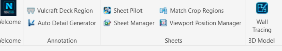

# NdevTools | Smart BIM Tools



**NdevTools** is a collection of Autodesk Revit productivity commands built for **pyRevit**. The extension combines model-based detailing, view and sheet management, and architectural-link wall tracing in one ribbon tab. It is developed by **Nataraj Devaraj**.

**GitHub:** [ndev16/NdevTools](https://github.com/ndev16/NdevTools)  
**Feedback and feature requests:** [GitHub Issues](https://github.com/ndev16/NdevTools/issues)

## Ribbon layout

| Panel | Ribbon button | Purpose |
| --- | --- | --- |
| **Welcome** | Welcome | Show NdevTools information, useful links and contact details. |
| **Annotation** | Vulcraft Deck Region | Create a concrete filled region that follows a selected Vulcraft structural deck profile in section. |
| **Annotation** | Auto Detail Generator | Trace selected host-model geometry into 2D filled regions, lines and supported detail components. |
| **Sheets** | Sheet Pilot | Configure and place up to 25 unplaced views per sheet across multiple sheets using saved viewport positions. |
| **Sheets** | Sheet Manager | Create sheets in bulk or rename existing sheets. |
| **Sheets** | Match Crop Regions | Apply one plan view's crop region to multiple compatible plan views. |
| **Sheets** | Viewport Position Manager | Save, rename, manage and reuse named sheet viewport positions. |
| **3D Model** | Wall Tracing | Re-create supported structural wall geometry in the host model from a linked architectural model. |

## Tools and usage

### Welcome

Open the **Welcome** button in the Welcome panel to view the extension's information and the developer's GitHub, LinkedIn and feedback links. The Welcome command is for information and navigation; it does not modify the open Revit model.

### Annotation → Vulcraft Deck Region

Create a static **concrete filled region** based on the corrugated profile of structural metal decking in a straight Revit section view.

**Supported deck configurations:** Vulcraft **1.5C-36, 2C-36 and 3C-36**, with the selectable gages offered by the command. The profile uses deck dimensions such as depth, pitch, upper and lower flats.

**Typical workflow:** Open a straight section, select the structural floor, choose the deck profile and gage, pick the **left end of a lower flat** as the profile anchor, and select the desired Revit filled-region type. The command generates a concrete region aligned to the deck geometry, with profile extent clipped to the selected floor boundaries.

**Scope:** Requires a valid selected structural floor, visible deck geometry and an accurately picked anchor. The result is 2D view-specific annotation, not replacement 3D geometry.

### Annotation → Auto Detail Generator

Create 2D construction-detail representations from visible, supported host-model elements in **plan views and straight sections**.

**Supported model categories:** floors, walls, roofs, structural foundations and structural framing.

**Typical workflow:** Open a supported view, launch Auto Detail Generator, choose a filled-region type and outline style for each model category, select the model elements, and create the view-specific detailing. Choose **No Fill** with a line style where you prefer detail lines instead of filled regions.

**Additional detailing options:**

- **Roofs:** place compatible line-based detail components along straight roof slopes in sections or roof top-face edges in plans.
- **Floors:** place line-based detail components along traced horizontal floor segments, splitting at openings where applicable.
- **Structural framing:** choose a loaded point-based or line-based detail component, or **None**, and align detail components with the traced framing center.
- **CMU walls:** replicate repeating-detail instances horizontally or vertically in sections using an existing instance as a template.

**Scope:** Creates static 2D representations. Curved roof edges are not supported. The command traces host-model elements; plan wall tracing uses the main view cut height, not the cut heights of individual plan regions.

### Sheets → Sheet Pilot (Place Views on Sheet)

**Sheet Pilot** automates placing unplaced views on multiple Revit sheets using named X/Y positions saved by **Viewport Position Manager** (or the compatible Crop Position Manager). Configure multiple sheets in one window, with up to **25 views per sheet**.

**Prerequisites — save a sheet position first:**

1. Manually place a reference view on a Revit sheet and arrange its viewport where you want it.
2. Open **Viewport Position Manager**, select the placed viewport, and use **Save New Position** or **Capture New Position + Apply** to acquire and save the viewport's X/Y sheet position under a recognizable name.
3. Repeat for any additional sheet locations needed. **At least one saved position is required** for Sheet Pilot. Saved positions are maintained separately by Revit version.

**Typical workflow:** Open Sheet Pilot, expand a target sheet, select **+ Add View**, choose an available unplaced view, its viewport type, and a saved position. Repeat for other views and sheets, then click **PLACE ALL VIEWS**. The same saved position can be selected again where appropriate; review placements to prevent overlaps.

**Placement and safety:** For standard viewports, the tool first creates a viewport at a temporary sheet location, then moves the existing viewport to the selected saved X/Y coordinate. For supported plan views it temporarily hides the four visibility category groups and Revit links during repositioning, then restores the original visibility and view template without repositioning again. Three-dimensional views, drafting views, legends and schedules bypass that visibility procedure; schedules use their insertion point. Each view's placement is independently rollback-protected on failure.

### Sheets → Sheet Manager

Two workflows are available within one command:

**Create Sheets:** Choose a title block, enter multiple sheet records such as `S1.1 - FOUNDATION SLAB PLAN`, and create them in a batch.

**Rename Sheets:** Select existing sheets, change their numbers or names, and apply the changes together. Validation catches duplicate or invalid sheet numbers; the rename workflow also supports number swaps and reports results.

Built-in help links provide access to the project's GitHub and developer information.

### Sheets → Match Crop Regions

Match model crop boundaries from one reference plan view to several target plan views.

**Typical workflow:** Choose a compatible reference plan with an enabled, **unsplit** crop region; select the target plan views; decide whether to copy the source view scale; and apply the crop regions. Target scales are preserved if scale copying is disabled.

The command uses model coordinates, handles compatible crop visibility and annotation-crop offsets, and removes target split crops where possible. Targets with scope-box-controlled crops are skipped. View-specific failures are reported without stopping the remaining targets.

### Sheets → Viewport Position Manager

Use named positions to standardize sheet layouts. The command supports **Apply Saved Position**, **Save New Position**, **Capture New Position + Apply**, **Show Saved Positions**, **Rename**, **Overwrite** and **Delete**.

**Typical workflow:** Start with a reference viewport already placed on a sheet. Save its X/Y coordinates as a named position, then apply that position to one or more selected viewports. You can also capture and immediately apply a new position.

The command stores up to **10 positions per Revit version** and maintains separate position sets for different Revit versions. When applying coordinates, it temporarily adjusts supported category and link visibility, then restores original visibility, templates and pinned state.

### 3D Model → Wall Tracing

Trace supported architectural **Basic Walls** from a loaded Revit link into structural walls in the active host project.

**Typical workflow:** Open a host project in a plan or 3D view; select a loaded architectural link; select source levels; map each to host bottom and top levels; review suggested host Basic Wall types; and click **Create Walls**. Set a source type to **None** to skip it. Review the created, duplicate, skipped and error results.

**Geometry and alignment:** Only straight, vertical Basic Walls with an identifiable positive-width structural layer are eligible. The thickest `Structure [1]` layer controls alignment; type suggestions are based on thickness, not a material-equivalence guarantee. Selected host levels and applicable source offsets are used.

**Safety behavior:** The source link is read-only. Wall creation runs inside a host transaction group and skips matching host walls. Curved, slanted, tapered, attached and edited-profile source walls are skipped. The command does not analyze or reconstruct wall openings. Automatic joins are managed during creation; to allow joins on existing selected host walls, select them and launch **Wall Tracing** again.

For more details, see the [Wall Tracing usage guide](NdevTools.tab/3D%20Model.Panel/Create%20walls.pushbutton/README_Wall_Tracing.md).

## Installation

1. Install **Autodesk Revit** and **pyRevit**.
2. Download this repository as a ZIP (or clone it).
3. Extract the repository files into a folder named **`NdevTools.extension`** inside a pyRevit extensions location. The `NdevTools.tab` folder and `extension.json` must sit directly inside `NdevTools.extension`.
4. If your folder is not already registered with pyRevit, add its parent extensions location using pyRevit's settings or extension configuration.
5. Reload pyRevit or restart Revit. The **NdevTools** ribbon tab displays the Welcome, Annotation, Sheets and 3D Model panels.

**Folder structure (abbreviated):**

```text
NdevTools.extension/
├── extension.json
├── NdevTools.tab/
│   ├── bundle.yaml
│   ├── Welcome.panel/
│   │   └── Welcome.pushbutton/
│   ├── Annotation.panel/
│   │   └── col1.stack/
│   │       ├── Conc Slab on metal deck.pushbutton/
│   │       └── Detail Generator.pushbutton/
│   ├── Sheets.panel/
│   │   ├── col1.stack/
│   │   │   ├── BulkPlaceViews.pushbutton/   # Sheet Pilot
│   │   │   └── Rename Sheets.pushbutton/
│   │   └── col2.stack/
│   │       ├── Crop Extents.pushbutton/
│   │       └── Viewport Position Manager.pushbutton/
│   └── 3D Model.Panel/
│       └── Create walls.pushbutton/
├── README.md
└── LICENSE
```

Each command includes the script and icon, plus its bundle configuration and any additional XAML, images or support modules it uses. Keep the button folders intact.

## Compatibility

Commands are written for **pyRevit** and the IronPython 2.7 runtime, using Revit API patterns for **Revit 2022–2027** where supported by the individual tools. Some commands have view, family, category or loaded-link prerequisites; review each tool's usage section above.

## What's new

The current ribbon expands the original sheet-management-focused repository with:

- A **Welcome** and contact/about experience.
- **Vulcraft Deck Region** and **Auto Detail Generator** in the Annotation panel.
- An expanded **Sheets** panel with two stacked button columns, multi-sheet Sheet Pilot placement, and viewport visibility handling.
- **Wall Tracing** in the 3D Model panel.
- Updated ribbon layout, icons, and documentation.

See [CHANGELOG.md](CHANGELOG.md) for the summary of this update.

## Support and feedback

Use [GitHub Issues](https://github.com/ndev16/NdevTools/issues/new) for bug reports and feature suggestions. When describing an issue, include the Revit and pyRevit versions, tool name, steps and any useful screenshots or error messages.

**Developer:** Nataraj Devaraj  
**GitHub:** https://github.com/ndev16  
**LinkedIn:** https://www.linkedin.com/in/nataraj016/  
**Email:** devnataraj39@gmail.com

## License

Copyright (C) 2026 Nataraj Devaraj. Released under the **GNU General Public License v3 (GPL-3.0-only)**. See [LICENSE](LICENSE) for details.
